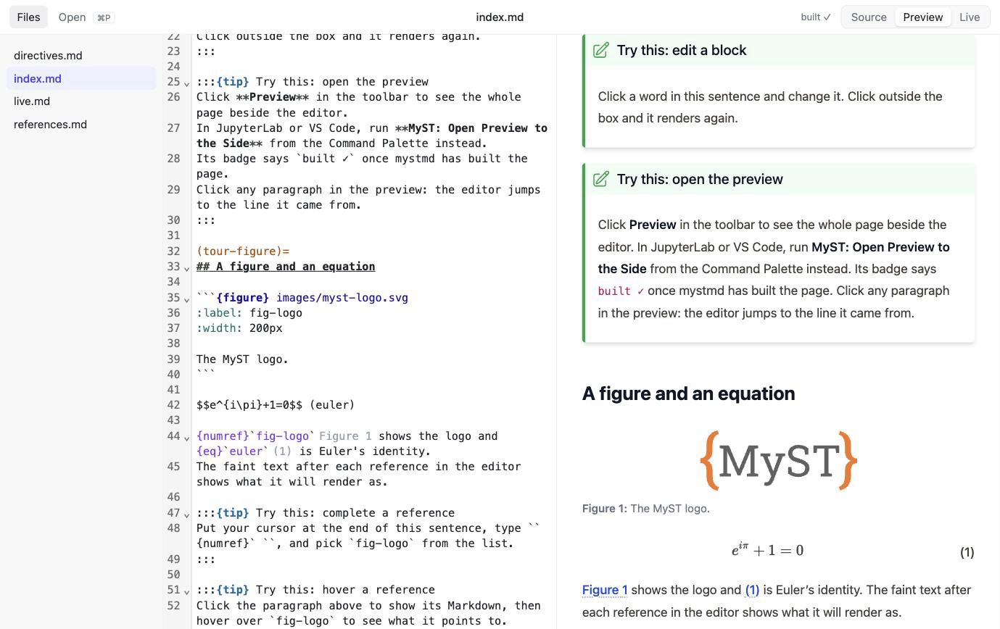

# MyST Author

[](https://codespaces.new/choldgraf/myst-author)
[](https://mybinder.org/v2/gh/choldgraf/myst-author/main?urlpath=lab/tree/docs/examples/tour/index.md)

An editor for [MyST](https://mystmd.org) projects.
You write Markdown and see it rendered in place, with the block you're editing showing its source.
Cross-references are completed and checked as you type, across the whole project.



> [!NOTE]
> This is an early prototype.
> Expect rough edges, and please open an issue when you find one.

It comes in three flavours, which share the same features:

- **A web editor**, for writing a MyST project in your browser.
- **A VS Code extension** ([docs](https://chrisholdgraf.com/myst-author/guide/vscode)), if you already write in VS Code.
- **A JupyterLab extension** ([docs](https://chrisholdgraf.com/myst-author/guide/jupyterlab)), if you write in JupyterLab or JupyterHub.

None of them are packaged yet, so you run each one from a clone of this repository, or try them on Codespaces or Binder.

## Project goals

The goals of this repository are to explore how much work we'd need to do in order to enable an editor-like experience with MyST.
We want to identify the building blocks that could _enable_ this end result, and use this repository to build them out and see how complex it is.

The building blocks live in separate repositories that are each useful on their own; see [How the repositories fit together](https://chrisholdgraf.com/myst-author/develop/repositories).

## Try it

Click one of the badges above to open the [tour project](docs/examples/tour/) in your browser.

To run it on your computer, you need Node 24 or newer.
[mystmd](https://mystmd.org/guide/installing) is recommended.

```bash
git clone https://github.com/choldgraf/myst-author && cd myst-author
npm install
npm run demo                     # a copy of the tour; or `npm start -- path/to/your/project`
```

To run it from any folder as `myst-author`, run `npm link -w packages/app` once.
See [Get started](https://chrisholdgraf.com/myst-author/get-started) for more options, and for what works without mystmd.

## Documentation

See [the documentation](https://chrisholdgraf.com/myst-author/) to get started, take the guided tour, and learn how the pieces fit together.
To work on MyST Author itself, see [Contributing](docs/develop/contributing.md).

## Development workflow

A lot of this has been written with the assistance of Claude Opus 5.5.
This is partially because the main goal of this repo is to create a proof of concept, see what is possible, and see what opportunities there are for upstreaming pieces that need more attention and care.
