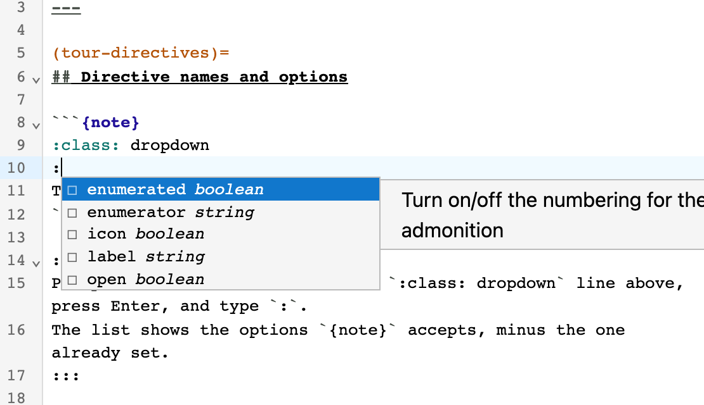

The editor completes directive names, role names, and directive options, and shows mystmd's description of each on hover.
This comes from [mystmd-lsp](https://chrisholdgraf.com/mystmd-lsp/features), whose features page lists what it completes and checks.

## Syntax highlighting

The web editor and VS Code highlight MyST syntax with [myst-syntax](https://github.com/choldgraf/myst-syntax), which lists what it covers.
In JupyterLab, install jupyterlab-myst-syntax from the same repository, as [JupyterLab](jupyterlab.md) describes.

## Known limits

Plugin directives and roles from your `myst.yml` aren't in the completion lists, and the fast preview doesn't render them.
The built preview does.
