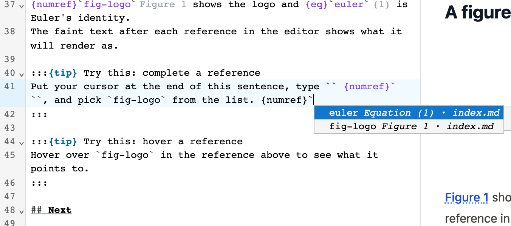
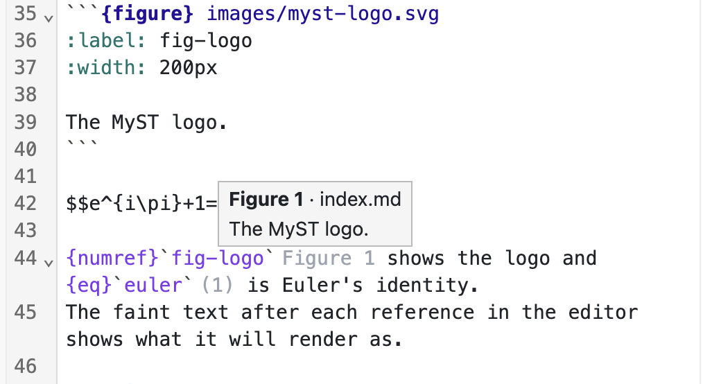
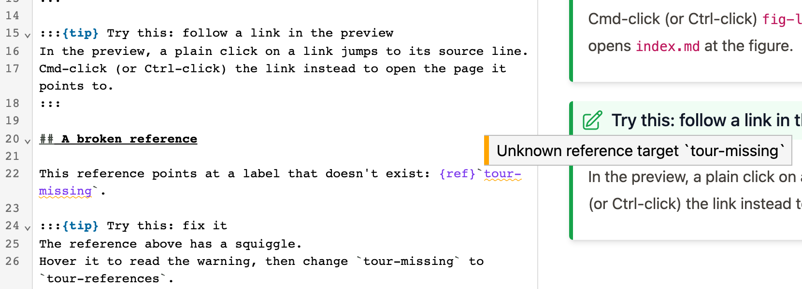

The editor helps you write cross-references: it completes them, shows what they point to, and warns about broken ones.
This help comes from [mystmd-lsp](https://chrisholdgraf.com/mystmd-lsp/), a language server that keeps track of the labels in your project.
Its [features page](https://chrisholdgraf.com/mystmd-lsp/features) lists everything it does and its limits, including citations and external references (`xref:`).

## Completion

Start typing a reference, such as `` {ref}` `` or `@`, and a list of targets appears.
Each item shows the label, what it is (for example `Figure 1`), and the file it's in.

## Hints and hover

A hint is faint text after a reference.
It shows what readers will see in its place, such as `Figure 1` or `(1)`.
Hover a reference to see what it points to and which file it's in.

## Go to definition, find references, and rename

- Cmd-click (or Ctrl-click) a reference, or press {kbd}`F12`, to go to its target.
- Press {kbd}`Shift+F12` on a reference or a label's definition to list every reference to that label.
- Press {kbd}`F2` to rename a label and every reference to it.
  The server finds every reference in the project, but the web editor and JupyterLab only change files that are open.
  Use VS Code to rename across the project.

## Warnings

A reference to a label that doesn't exist gets a squiggle.
Hover it to read the warning.

Warnings for unknown labels appear only after mystmd's first build has loaded, so you don't get them [without mystmd](../get-started.md#run-it-locally).
